# Improved Dung Beetle Optimization - Utilizing Levy Flight and Triangular Wandering Strategies

Today, we bring you an improved version of the Dung Beetle optimization algorithm. Previously, an article introduced the Improved Sinusoidal Algorithm-Driven Dung Beetle Optimization Algorithm (MSADBO). However, this article has already been published in a paper.
The improvements introduced today are entirely personal and should not be found on the internet. They can serve as a reference for everyone, and you can continue to improve upon these foundations.
The improvement strategy is as follows:
1. Utilize the Cubic chaotic map, formula as follows:
Cubic mapping is used to increase particle diversity. Can reduce the particle optimization time. Increase the convergence speed of the algorithm. Those who want to improve the algorithm by using other chaotic mappings. You can refer to this article: 10 Chaos Map Optimization Grey Wolf Algorithms. One-click switch. Can be used to optimize all swarm intelligence algorithms. Taking the Grey Wolf Algorithm as an example.
② Utilize the triangle roaming strategy.
Improvements made during the foraging phase of the Dung Beetle beetle, allowing it to move around food without directly approaching it, increasing randomness. The formula for the triangle-walking strategy is as follows:
Subsequently, the direction of walking is defined according to the following formula.
The following formula is used to determine the position obtained by the Dung Beetle after it has moved.
③Levy flight and greedy strategy
Levy flight is a highly effective method for providing random factors. Levy flights can provide stochastic walk methods with step lengths that follow the Levy distribution. However, Levy flights sometimes have excessively long steps. To better align with Dung Beetle' foraging behavior, Levy flights are multiplied by a constant C to reduce the step length. The formula for the Levy flight walk strategy is as follows.
After the Levy flight mechanism ends, adopt a greedy strategy. If the fitness of a particle is less than that of its predecessor, replace it.
Results display
To demonstrate the necessity of each strategy, the author has compared each strategy.DBOOriginal Dung Beetle Algorithm, TWDBOCicada Algorithm with Triangle Sweeping Strategy, LTWDBOCicada Algorithm for Integrating Levi-Strauss Flight and Triangular Walking Strategies.  
Here are some screenshots, which show that the effect is still very good.
Code display
clear all \nclc\nclose\n\nPD_no=50;      %Number of sand cat\nF_name='F11';     %Name of the test function\nMax_iter=1000;    %Maximum number of iterations\n[LB,UB,Dim,F_obj]=CEC2005(F_name); %Get details of the benchmark functions\n\n%% DBO    \n[Best_pos,Best_score, DBO_cg_curve ] = DBO(PD_no,Max_iter,LB,UB,Dim,F_obj); % Call DBO\nfprintf ('Best solution obtained by DBO: %s\n', num2str(Best_score,'%e  '));\ndisplay(['The best optimal value of the objective funciton found by DBO  for ' [num2str(F_name)],'  is : ', num2str(Best_pos)]);\n\n%% TWDBO    \n[IBest_pos,IBest_score, TWDBO_cg_curve ] = TWDBO(PD_no,Max_iter,LB,UB,Dim,F_obj); % Call DBO\nfprintf ('Best solution obtained by TWDBO: %s\n', num2str(IBest_score,'%e  '));\ndisplay(['The best optimal value of the objective funciton found by TWDBO  for ' [num2str(F_name)],'  is : ', num2str(IBest_pos)]);\n%% LTWDBO    \n[LTWDBOBest_pos,LTWDBOBest_score, LTWDBO_cg_curve ] = LTWDBO(PD_no,Max_iter,LB,UB,Dim,F_obj); % Call LTWDBO\nfprintf ('Best solution obtained by LTWDBO: %s\n', num2str(LTWDBOBest_score,'%e  '));\ndisplay(['The best optimal value of the objective funciton found by LTWDBO  for ' [num2str(F_name)],'  is : ', num2str(LTWDBOBest_pos)]);\n\n%%\n\nCNT=40;\nk=round(linspace(1,Max_iter,CNT)); % Randomly select CNT points\n% Note: If the number of points drawn from the convergence curve is small, and the random points are sparse, it indicates that the number of points has been insufficient. At this time, the number of points should be increased gradually, such as 100, 200, 300, etc.\n% On the contrary, if the random points on the convergence curve are very dense, it indicates that too many points have been taken. At this time, the number of points should be reduced.\niter=1:1:Max_iter;\nfigure('Position',[154   145   894   357]);\nsubplot(1,2,1);\nfunc_plot(F_name);     % Function plot\ntitle('Parameter space')\nxlabel('x_1');\nylabel('x_2');\nzlabel([F_name,'( x_1 , x_2 )'])\nsubplot(1,2,2);       % Convergence plot\nsemilogy(iter(k),DBO_cg_curve(k),'b-*','linewidth',1);\nhold on\nsemilogy(iter(k),TWDBO_cg_curve(k),'r-^','linewidth',1);\nhold on\nsemilogy(iter(k),LTWDBO_cg_curve(k),'g-o','linewidth',1);\nxlabel('Iteration#');\nylabel('Best fitness so far');\nlegend('DBO','TWDBO','LTWDBO');\n\n  

## Images

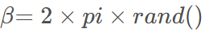

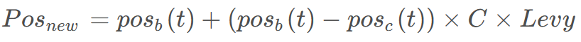
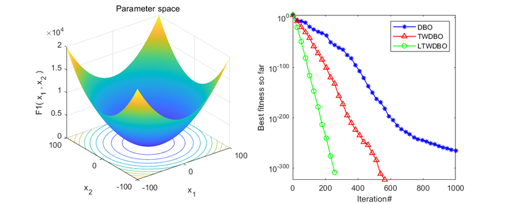
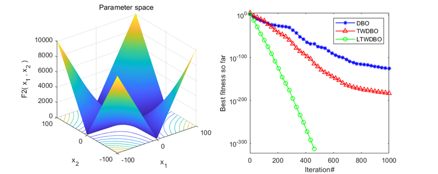
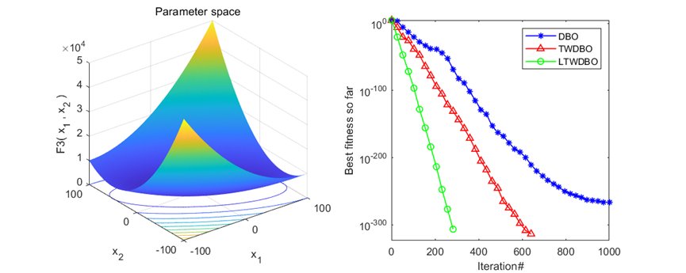
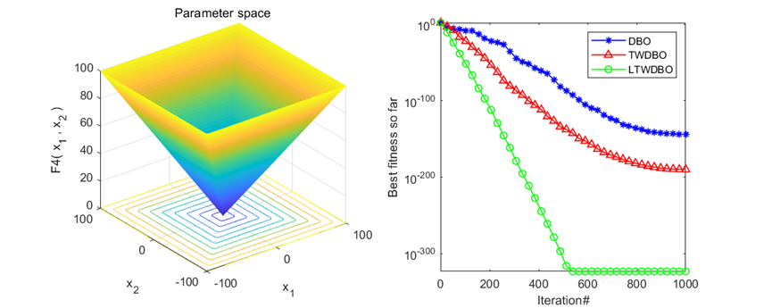
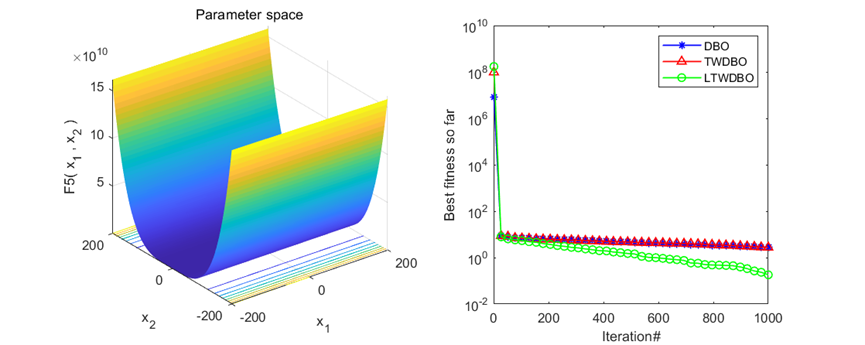
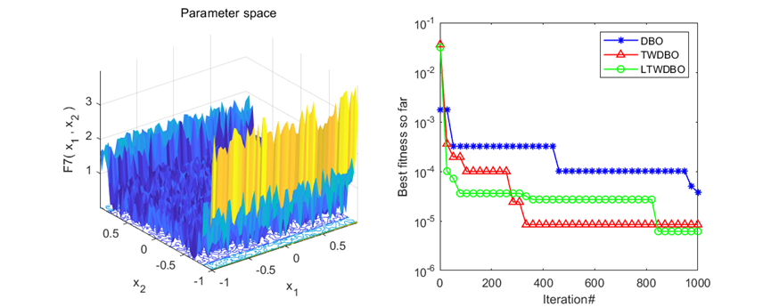
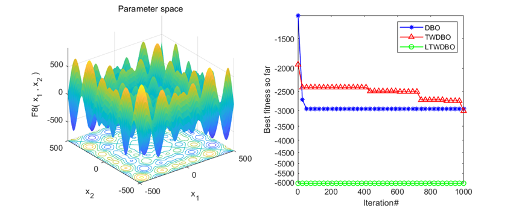
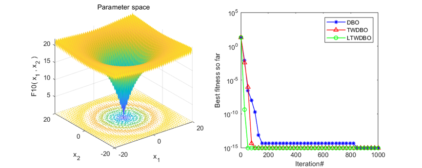
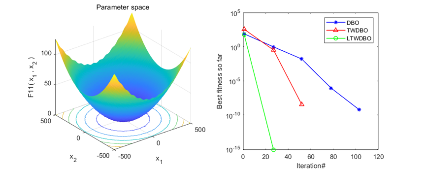
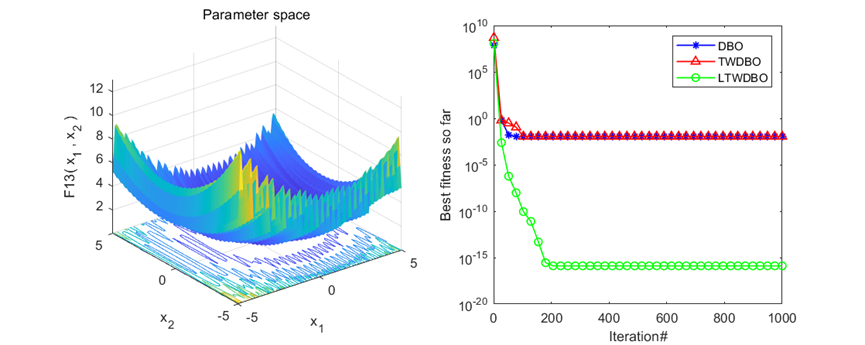

<!-- PAYMENT_BLOCK -->

## Get this dataset

- Payment link (Stripe): [Buy now](https://buy.stripe.com/3cs8yP7sY87d0vu9AB)
- Payment QR code: 

<!-- /PAYMENT_BLOCK -->
